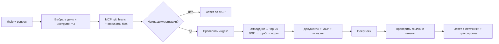

# День 31 — Ассистент разработчика

Веб-ассистент отвечает на `/help` по README и docs репозитория AI Advent Challenge. Через MCP получает текущую git-ветку, состояние рабочего дерева и список файлов. Ответы по документации сопровождаются проверенными цитатами, а под каждым запросом можно раскрыть шаги пайплайна.

## Запуск

Нужны JDK 21, Ollama с `nomic-embed-text`, ключ DeepSeek и BGE-реранкер, как в днях 23–28.

```bash
cd day31
cp .env.example .env       # вписать DEEPSEEK_API_KEY
ollama pull nomic-embed-text
./run.sh
```

Чат: http://localhost:8311. MCP: http://127.0.0.1:8312/mcp.

`run.sh` собирает оба модуля, запускает MCP и ассистента, а если реранкер на порту 8012 ещё не запущен — поднимает его из существующего файла `day23/data/models/bge-reranker-v2-m3-FP16.gguf` или из `day31/data/models/`. При выходе останавливает только запущенные им процессы.

Если модели реранкера ещё нет:

```bash
brew install llama.cpp
mkdir -p data/models
curl -fL --retry 3 https://huggingface.co/gpustack/bge-reranker-v2-m3-GGUF/resolve/main/bge-reranker-v2-m3-FP16.gguf -o data/models/bge-reranker-v2-m3-FP16.gguf
```

Можно запустить модули отдельно в двух терминалах из `day31`:

```bash
./gradlew :project-mcp:run
./gradlew :assistant:bootRun
```

Во втором варианте реранкер необходимо запустить отдельно на порту 8012. Spring Boot читает `.env`; MCP получает `PROJECT_ROOT` и `MCP_PORT` из окружения, по умолчанию `..` и `8312`.

## Примеры

```text
/help
/help Как устроен day31 и какие в нём модули?
/help Какие модели нужны для запуска day28?
/help Как устроена очередь запросов в day30?
/help На какой git-ветке я сейчас работаю?
/help Какие файлы есть в day31?
/help Что изменено в рабочем дереве?
```

В интерфейсе можно выбрать день. Упоминание `dayN` в вопросе важнее выбора. Разные дни имеют разные модели, порты и правила, поэтому поиск документации ограничивается выбранным днём до реранкинга. Для общего вопроса доступен весь репозиторий. Если в вопросе названы два дня, ассистент просит выбрать один.

## Пайплайн



- RAG читает существующие `dayN/README.md` и Markdown из `docs` напрямую, без ручного копирования в корпус. Документация нового ассистента находится в [`docs`](docs/architecture.md).
- Структурная нарезка, эмбеддинги, SQLite, BGE-реранкер и проверка цитат переиспользованы из дня 28. MCP-транспорт и SDK — из дня 19.
- Индекс проверяется по хешу перед каждым поиском. Ветка запрашивается через MCP заново при каждом вопросе.
- Вопросы только о ветке, статусе и файлах работают без RAG, реранкера и генерации LLM. `/help` без аргументов показывает справку.
- При пустом поиске или отсутствии ответа ассистент сообщает об этом. Ошибки MCP видны как предупреждения; неподтверждённый ответ модели не выдаётся за достоверный.
- История хранится в браузере. В модель передаются до трёх обменов только выбранного проекта. Трассировки: 100 последних в памяти сервера, индекс — SQLite в `data/index`.
- Наличие цитаты подтверждает источник, но не гарантирует правильность смыслового вывода. Качество проверяется контрольными вопросами.

## Настройки

| Переменная | По умолчанию |
|---|---|
| `DEEPSEEK_API_KEY` | не задан; нужен для ответов по документации |
| `DEEPSEEK_MODEL` | `deepseek-flash` |
| `DEEPSEEK_BASE_URL` | `https://api.deepseek.com` |
| `PROJECT_ROOT` | `..` |
| `PORT` | `8311` |
| `MCP_PORT` | `8312`, для запуска отдельного MCP — переменная окружения |
| `PROJECT_MCP_URL` | `http://127.0.0.1:8312/mcp` |
| `OLLAMA_BASE_URL` | `http://localhost:11434` |
| `OLLAMA_EMBED_MODEL` | `nomic-embed-text` |
| `RERANKER_BASE_URL` | `http://127.0.0.1:8012` |

Ключ существует только на сервере и не возвращается API. MCP выполняет фиксированные команды чтения git, список файлов ограничен, скрытые и приватные файлы исключены. Оба сервиса слушают localhost.

## Проверка

```bash
./gradlew test
python3 tools/smoke.py            # при запущенном приложении
```

Smoke-прогон проверяет команду `/help`, живую ветку через MCP, структуру дня 31, запуск и очередь дня 30, модели дня 28, список файлов, git status, отсутствие ответа и изоляцию выбранного дня. Результаты с ответами и источниками сохраняются в `data/eval/smoke.json`.

API, формат ответа и инструменты подробно описаны в [`docs/api.md`](docs/api.md), индексация и поиск — в [`docs/rag.md`](docs/rag.md).
