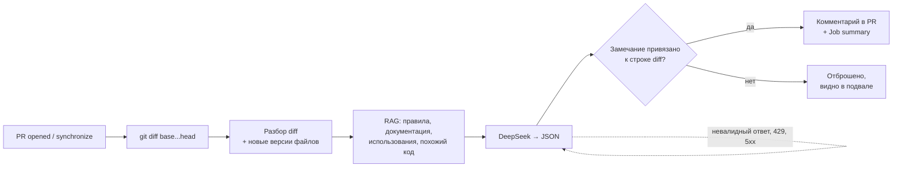

# День 32 — AI-ревью pull request

На каждый PR в репозитории GitHub Actions запускает ревьюера. Он берёт diff и изменённые файлы, собирает контекст из документации и кода проекта, просит DeepSeek найти проблемы и публикует в PR один комментарий с тремя разделами: 🐛 потенциальные баги, 🏗️ архитектурные проблемы, 💡 рекомендации. При следующем push тот же комментарий обновляется.

Для демонстрации есть песочница [`sandbox`](sandbox/README.md): небольшой сервис бронирования переговорок с явными правилами. Демо-PR меняют её код, и ревьюер проверяет их по этим правилам.

## Пайплайн



| Этап | Что происходит |
|---|---|
| Trigger | `.github/workflows/ai-review.yml` — события `pull_request`, только PR из этого репозитория, не черновики |
| Input | `git diff base...head` в том же виде, что вкладка «Files changed»; новые версии изменённых файлов из checkout PR |
| RAG | правила [`docs/review-rules.md`](docs/review-rules.md) целиком, README и `docs` затронутых папок по смыслу изменений, места использования изменённых символов в неизменённом коде, похожий код модуля |
| Agent | DeepSeek получает пронумерованные фрагменты и листинг каждого изменённого файла с маркерами `+`/`-` и номерами строк |
| Output | замечания проходят проверку и публикуются одним комментарием с маркером `<!-- ai-review -->` |

## RAG: документация и код

- **Правила ревью.** Корневой `CLAUDE.md` в репозиторий не попадает, поэтому общие правила (секреты, слои, время, конкурентность) лежат в `docs/review-rules.md`. В контекст они идут целиком при каждом ревью.
- **Документация.** README и Markdown затронутых папок верхнего уровня (`dayN`) режутся структурным чанкером дня 28. По смыслу изменений выбираются 6 ближайших кусков: эмбеддинги `nomic-embed-text` в Ollama и косинусная близость к запросу «путь + изменённые строки».
- **Использования.** Из добавленных и удалённых строк берутся объявленные имена (`fun overlaps`, `class BookingService`). Затем в неизменённом коде модуля ищутся места, где они встречаются. Так ревьюер видит код, который изменение может сломать, даже если он не попал в diff.
- **Похожий код.** Куски кода модуля, близкие по смыслу к изменениям. Модуль — ближайшая к изменённому файлу папка со своим `build.gradle.kts`: PR в песочницу не тянет код самого ревьюера.
- Изменённые файлы модель видит целиком (до 600 строк), поэтому их куски в фрагменты не дублируются.
- Из дня 31 переиспользованы клиенты DeepSeek и Ollama и структурный чанкер Markdown (туда он пришёл из дня 28). Идея проверки ответа та же, что у цитат дня 31: модель обязана указать дословный текст, и его наличие проверяется.

## Проверка ответа и ошибки

- Каждое замечание должно указывать файл из diff и строку из изменённого участка. Строка ищется по дословному коду из ответа: модель часто ошибается номером на одну-две строки, но не текстом. Если номер сбит, он исправляется. Замечание о чужом файле или о строке вне изменений отбрасывается, причина видна в подвале комментария.
- Номера источников проверяются по списку фрагментов, несуществующие выбрасываются.
- Retry: до 3 попыток. Невалидный JSON или ответ, обрезанный лимитом, — повтор с уточнением, что не так. Таймаут, 429 и 5xx — повтор с паузой. Неверный ключ (401) не повторяется.
- Fallback: если Ollama недоступна, контекст собирается без семантического поиска — правила и места использования остаются. В комментарии появляется пометка.
- Если ревью не выполнено, комментарий всё равно публикуется с дословной причиной, а job становится красным.
- Ревью рекомендательное: merge оно не блокирует.

## Метрики

В подвале каждого комментария есть таблица этапов со временем, число токенов, попыток и оценка стоимости по пиковому тарифу `deepseek-flash` ($0.30 за миллион входных токенов, $1.20 за миллион выходных).

Замеры на [демо-PR #1](https://github.com/helpsolution/AI-Challenge/pull/1) «перенос брони» с семью заложенными проблемами:

| Прогон | Job целиком | Ревью (RAG + LLM) | Токены | Стоимость | Замечаний |
|---|---|---|---|---|---|
| локально, 4 файла, +29 −3 | — | 7,6–12 с | ~6–7 тыс. → 1,3–1,4 тыс. | ≈ $0.004 | 6–7, покрыты все 7 проблем |
| CI, тот же diff | 1 мин 38 с | 13,6 с (7,0 + 6,6) | 6427 → 1204 | ≈ $0.0034 | 5, покрыты 6 из 7 |
| CI, после исправлений, 3 файла | 1 мин 42 с | 18,4 с (15,1 + 3,2) | 6146 → 398 | ≈ $0.0023 | 1 — оставленная проверка в контроллере |

Из минуты с лишним job около 25 с уходит на Ollama, 20–55 с на сборку (с кэшем Gradle и без него). Само ревью укладывается в цель лекции < 60 с, стоимость — в < $0.10 за PR. Ответы модели от прогона к прогону немного различаются: две соседние проблемы иногда объединяются в одно замечание.

## Запуск

### В GitHub

1. Задать секрет репозитория `DEEPSEEK_API_KEY`: Settings → Secrets and variables → Actions, или `gh secret set DEEPSEEK_API_KEY`.
2. Открыть PR. Workflow скачает Ollama 0.40.2, запустит `ollama serve` (systemd на раннере не работает, поэтому `install.sh` сервер не поднимает), скачает `nomic-embed-text`, соберёт ревьюера и опубликует комментарий.

### Локально

Нужны JDK 21, Ollama с `nomic-embed-text` и ключ DeepSeek.

```bash
cd day32
cp .env.example .env     # вписать DEEPSEEK_API_KEY
./review.sh              # ревью изменений рабочего дерева относительно main
./review.sh origin/main  # или относительно другой ветки
```

Результат пишется в `data/review.md`, тот же Markdown, что уходит в PR. Неотслеживаемые файлы в `git diff` не попадают: новый файл нужно хотя бы добавить в индекс.

## Настройки

| Переменная / свойство | По умолчанию |
|---|---|
| `DEEPSEEK_API_KEY` | не задан; без него ревью не выполняется |
| `DEEPSEEK_MODEL` | `deepseek-flash` |
| `OLLAMA_BASE_URL` | `http://localhost:11434` |
| `OLLAMA_EMBED_MODEL` | `nomic-embed-text` |
| `REVIEW_LINK_BASE` | пусто; в CI — `https://github.com/<repo>/blob/<sha>` для ссылок на строки |
| `review.docs-limit`, `review.code-limit`, `review.usages-limit` | 6, 6, 8 фрагментов |
| `review.full-file-lines` | 600: файл длиннее показывается модели только участками diff |
| `review.llm-attempts` | 3 |

## Безопасность

- Триггер — `pull_request`, а не `pull_request_target`. PR из форка не получает секрет и не запускает ревью, поэтому чужой код не выполняется с ключом.
- Токен job ограничен правами `contents: read` и `pull-requests: write`. Checkout без сохранённых учётных данных.
- В shell-шаги не подставляются тексты из PR (заголовок, описание, ветка) — только SHA и номера, так что инъекции команд через них нет.
- Diff и код — недоверенные данные. У модели нет инструментов, она возвращает только JSON. Внедрённая в код инструкция может испортить лишь текст комментария.
- Ключ DeepSeek существует только в секретах и `.env`, в лог и комментарий не выводится.
