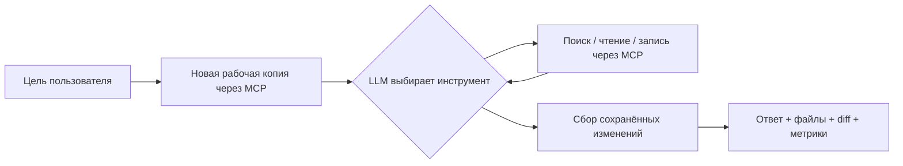

# День 34 — Смотритель: ассистент сопровождения проекта

Ассистент сам находит и читает файлы Kotlin-проекта, сопоставляет код с документацией и сохраняет результат в отдельной рабочей копии. Пользователь задаёт цель, без списка файлов и команд инструментам. Реализованы два сценария: обновление документации API и проверка правил с отчётом.

## Запуск

Нужны JDK 21, Git и ключ DeepSeek. Ollama и индекс эмбеддингов для этого задания не нужны: ассистент читает актуальные файлы через MCP.

```bash
cd day34
cp .env.example .env       # задать DEEPSEEK_API_KEY
./run.sh
```

Интерфейс: http://localhost:8340. Файловый MCP: http://127.0.0.1:8341/mcp.

`run.sh` собирает и запускает два сервиса, ждёт готовности обоих и останавливает запущенные им процессы при выходе. Журналы — в `data/logs/`. Ключ хранится в игнорируемом `.env` на сервере; в браузер не передаётся.

Можно запускать модули отдельно из папки `day34`:

```bash
./gradlew :files-mcp:run
./gradlew :assistant:bootRun
```

В этом случае настройки MCP (`MCP_PORT`, `DEMO_PROJECT`, `WORKSPACES_DIR`) задаются переменными окружения; ассистент также читает `.env`. У модулей рабочая папка — `day34`.

## Два сценария для демонстрации

### 1. Актуализация документации

Выбрать карточку «Обновить документацию» и выполнить задачу:

> Проверь документацию API бронирований и обнови её по текущему коду. Исправь README и создай подробное описание API.

Ассистент изучает README, контроллер, модели, сервисы и настройки. В исходном README не описан `PATCH /api/rooms/{roomId}/bookings/{id}`, хотя перенос бронирования уже реализован. Результат — обновлённый `README.md` и новый `docs/api.md` с методами, запросами, ответами и ошибками по коду.

### 2. Проверка правил проекта

Создать новую задачу и выбрать «Проверить правила»:

> Проверь модуль бронирований на соответствие правилам проекта и сохрани отчёт с доказательствами и номерами строк.

Ассистент читает `docs/rules.md`, находит связанные исходники и создаёт `docs/audit.md`: статусы правил, доказательства с путями и строками, объяснения и ограничения анализа. В демо есть архитектурное нарушение: `BookingController.reschedule` проверяет длительность брони, хотя по правилам бизнес-проверки должны жить в сервисе. Код при аудите не изменяется.

В интерфейсе доступны итог, подсвеченный unified diff, тексты сохранённых файлов и скачивание diff/документов. Справа — вызовы инструментов с аргументами и результатами, ходы модели, время, токены и оценка стоимости. Раздел «Где сохранены файлы» показывает путь рабочей копии.

## Как устроен пайплайн



- `assistant` — Spring Boot, DeepSeek function calling и Vue 3; события стримятся через SSE. Схемы инструментов получаются из MCP `tools/list`, а не дублируются вручную.
- `files-mcp` — Kotlin MCP SDK, streamable HTTP. Выполняет операции с файлами; модель не получает shell и не исполняет анализируемый код.
- `demo/project` — небольшая копия исходников `day32/sandbox`, намеренно устаревший README и правила проекта. У примера нет отдельной сборки: это корпус для анализа.
- `data/workspaces/<uuid>/original` — исходный снимок конкретного запуска; `project` рядом с ним — рабочая копия с результатами. Обе сохраняются на диске и исключены из Git.

На входе сервер создаёт копию. Затем модель сама выбирает файлы и вызовы. По завершении сервер независимо собирает реальные изменения, строит diff и проверяет наличие сохранённых файлов и чтения минимум трёх файлов. Если результат не сохранён, статус — `incomplete`; ошибка сервиса даёт `failed`, даже если часть файлов успела сохраниться. Содержательную точность документации и выводов аудита оценивает человек: наличие diff не доказывает правильность текста.

## Инструменты MCP

| Инструмент | Назначение | Кто вызывает |
|---|---|---|
| `create_workspace` | Создать новый снимок и рабочую копию | сервер на входе |
| `list_files` | Получить пути и размеры текстовых файлов | модель |
| `search_text` | Поиск подстроки по нескольким файлам: путь, строка, текст | модель |
| `read_file` | Полный текст, нумерованные строки и SHA-256 | модель |
| `write_file` | Создать Markdown или заменить существующий с проверкой хеша | модель |
| `get_changes` | Сохранённые изменения, diff и прочитанные файлы | модель и сервер на выходе |

Параметр `workspace_id` убран из схем, которые видит модель, и всегда подставляется сервером. Модель не может переключиться на другую рабочую копию. Чтение ограничено текстовыми файлами внутри неё; скрытые файлы, абсолютные пути, `..` и символические ссылки запрещены. Запись разрешена только в `README.md` и Markdown внутри `docs/`. Перед изменением существующего файла инструмент требует его прочитать и передать актуальный хеш: устаревшая запись отклоняется. Исходный пример остаётся неизменным.

Каждая задача начинает с чистого примера, поэтому повторный прогон воспроизводит исходную ситуацию. Формулировки и дополнительные находки LLM могут отличаться. История интерфейса хранится в памяти вкладки; сами файлы остаются на диске после её закрытия. HTTP API рассчитан на локальное учебное демо, без пользовательской аутентификации.

## Ошибки и ограничения

- DeepSeek: обрыв, таймаут, 429 и 5xx — до трёх попыток с паузой; 401 не повторяется. Текст незавершённой попытки очищается из интерфейса.
- Неверный JSON аргументов, неизвестный инструмент или конфликт хеша возвращаются модели как ошибка инструмента: она может исправить вызов на следующем ходе.
- Цикл ограничен 16 ходами. На последнем инструменты отключаются, модель сообщает итог по уже выполненным действиям.
- При недоступном MCP или отсутствии ключа показывается причина. Ошибка получения изменений не выдаётся за успешное завершение.
- Если поток в браузере оборвался, интерфейс пытается получить уже сохранённые файлы отдельным запросом. Это не отменяет серверный запуск: он может ещё продолжаться.
- Аудит — статический анализ. Ассистент не запускает проект, не выполняет тесты и не гарантирует полноту найденных нарушений.

## Проверка

```bash
./gradlew :files-mcp:test :assistant:bootJar :files-mcp:installDist
# В другом терминале после ./run.sh:
python3 tools/smoke.py
```

Пять тестов файлового слоя проверяют изоляцию запусков, поиск по нескольким файлам, запрет чтения скрытых файлов и записи вне проекта, символические ссылки, конфликт хеша и точное применение скачанного патча, включая новые файлы и исходник без завершающего перевода строки.

Живая проверка запускает оба сценария и повторяет обновление документации на новой копии. Проверяет чтение минимум трёх файлов, наличие сохранённых результатов, описание `PATCH`, найденную бизнес-проверку в контроллере, скачивание и применение diff и неизменность исходного примера. Полные трассы — `data/eval/*.json`, сводка — `data/eval/summary.json`.

Живые замеры на `deepseek-flash` (три итоговых прогона):

| Сценарий | Файлов прочитано | Ходов LLM | Время | Оценка стоимости |
|---|---|---|---|---|
| Обновление документации | 11 | 7 | 25,0 с | $0.0261 |
| Аудит правил | 11 | 10 | 34,8 с | $0.0355 |
| Повторное обновление документации | 11 | 8 | 24,7 с | $0.0276 |

Все три прогона прошли проверки, включая применение diff. Стоимость рассчитана по настраиваемым коэффициентам из `application.yml`; это оценка, а не сумма из биллинга провайдера. В документации и аудите модель может делать дополнительные наблюдения или пропускать детали — результаты нужно просматривать.

## Настройки

| Переменная / свойство | По умолчанию |
|---|---|
| `DEEPSEEK_API_KEY` | не задан |
| `DEEPSEEK_MODEL` | `deepseek-flash` |
| `DEEPSEEK_BASE_URL` | `https://api.deepseek.com` |
| `PORT`, `MCP_PORT` | `8340`, `8341` |
| `FILES_MCP_URL` | `http://127.0.0.1:8341/mcp` |
| `DEMO_PROJECT` | `demo/project` |
| `WORKSPACES_DIR` | `data/workspaces` |
| `agent.max-steps` | 16 |
| `cloud-llm.max-tokens` | 6000 на ход |
| `LLM_INPUT_PRICE`, `LLM_OUTPUT_PRICE` | 0.30, 1.20 доллара за миллион токенов; изменяемые коэффициенты для оценки |

## Переиспользовано

- День 33: клиент DeepSeek со стримингом и повторами, DTO function calling, MCP-клиент и подключение схем через `tools/list`, Vue и дизайн-система Halo.
- День 32: исходники бронирования переговорок для воспроизводимого примера.
- Новое: файловый MCP, отдельная копия на каждый запуск, запись с проверкой хеша, сбор реального diff, два сценария сопровождения и интерфейс просмотра результатов.
