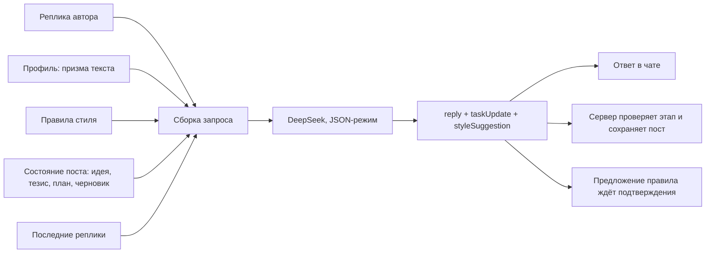

# День 35 Hard — редактор постов для Telegram-канала

Сервис, которым автор пользуется сам: открывает страницу, выбирает профиль и за несколько реплик получает готовый пост для своего Telegram-канала. Работает на VPS: **https://posts.91-188-212-44.sslip.io** — можно открыть и попробовать, вход не нужен.

## Какую задачу решает

Пост в личный канал обычно начинается с сырой мысли. Чтобы она стала текстом, нужно найти главный тезис, выстроить аргументы, написать черновик и несколько раз его поправить. Шаблонный генератор с этим не справляется: он пишет «за автора» и теряет его мысль. Редактор работает иначе. Он расспрашивает, предлагает тезис и план, пишет черновик и правит его по замечаниям. Устойчивые предпочтения автора («без хештегов в конце», «без назидательного финала») он запоминает и применяет во всех следующих постах.

## Как участвует AI



- **Ведение по этапам.** Модель сама решает, когда пора от идеи переходить к тезису, плану и черновику. Сервер проверяет переход: без идеи нельзя перейти к тезису, без тезиса — к плану.
- **Профиль — смысловая призма.** Название и описание профиля добавляются в каждый запрос. Один и тот же замысел через «Экономиста» и «Психолога» даёт разные аргументы и терминологию. Профили создаются и редактируются в интерфейсе.
- **Правила стиля — долговременная память.** Модель может только предложить правило. Сохраняется оно после кнопки «Запомнить» или явной просьбы «запомни…». Правила действуют во всех постах.
- **Структурированный ответ.** Модель возвращает JSON: текст для чата отдельно, изменения поста отдельно. Черновик лежит в панели «Пост», откуда его можно скопировать одной кнопкой.

Модель вызывается только на содержательных репликах. Выбор профиля, копирование, правка профилей и правил её не вызывают.

## Как пользоваться

1. Нажать «Новый пост», название можно не вводить: оно появится из темы.
2. Выбрать профиль кнопкой над полем ввода.
3. Рассказать, о чём пост. Отвечать на вопросы редактора, согласовать тезис и план.
4. Править черновик сообщениями: «короче», «убери второй абзац», «финал мягче».
5. Нажать «Скопировать» и вставить текст в Telegram.

## Локальный запуск

```bash
cd "day35 Hard"
cp .env.example .env    # указать DEEPSEEK_API_KEY
./gradlew bootRun
```

Открыть http://localhost:8360. База — `data/posts.db`. Порт, путь к базе и модель меняются через `PORT`, `DB_PATH` и `DEEPSEEK_MODEL`.

Профили по умолчанию («Химик», «Психолог», «Экономист») создаются один раз в пустой базе. Удалённый профиль после перезапуска не возвращается.

## Выкладка на VPS

```bash
deploy/deploy.sh user@91.188.212.44
```

Скрипт собирает jar и копирует его в `/opt/post-editor`. Затем он записывает ключ DeepSeek из локального `.env` в `/etc/post-editor.env` (права 600, ключ передаётся через stdin) и запускает systemd-сервис `post-editor`. Сайт подключается к Caddy отдельным файлом `/etc/caddy/sites/post-editor.caddy`. Caddy сам получает сертификат Let's Encrypt.

На том же VPS работает сервис дня 30 (Ollama + llm-service), поэтому:

- сервис слушает только `127.0.0.1:8360`, наружу он выходит через Caddy;
- JVM ограничена: `-Xmx160m`, SerialGC, C1 (около 160 МБ RSS);
- основной `Caddyfile` принадлежит выкладке дня 30. В её шаблон добавлен `import /etc/caddy/sites/*.caddy`, так что повторная выкладка любого из дней не удаляет сайт другого;
- новый конфиг Caddy сначала проверяется копией и применяется через `reload`, поэтому сервис дня 30 не перезапускается.

Повторный запуск обновляет приложение и ключ. Посты в `/var/lib/post-editor/posts.db` при этом сохраняются. Другой домен задаётся так: `DOMAIN=posts.example.com deploy/deploy.sh user@host`.

Эксплуатация:

```bash
ssh user@91.188.212.44 sudo journalctl -u post-editor -f           # журнал
ssh user@91.188.212.44 sudo systemctl restart post-editor          # перезапуск
scp user@91.188.212.44:/var/lib/post-editor/posts.db ./backup.db   # копия базы
```

## Ограничения

- **Авторизации нет.** Любой, кто знает адрес, может писать посты за счёт баланса DeepSeek и удалять чужие посты, профили и правила. Страница закрыта от индексации (`noindex`), но это не защита. Закрыть доступ можно без изменений кода — блоком `basic_auth` в `deploy/post-editor.caddy`.
- Ответ приходит целиком, без стрима: обычно за 3–10 секунд.
- В Telegram сервис ничего не публикует: с этого VPS Bot API недоступен. Готовый текст копируется кнопкой.
- OpenRouter с этого VPS тоже закрыт (`403 Access denied by security policy`), поэтому модель — DeepSeek. Правила формата
  ответа стоят в промпте последними: если они идут до истории, DeepSeek в JSON-режиме на длинном диалоге иногда
  отвечает сотнями пробелов.

## Проверка

```bash
./gradlew test
```

Тесты проверяют переходы между этапами, подтверждение правил стиля, сборку запроса с профилем и памятью, выбор профиля и автоназвание поста. Отдельно проверяется клиент DeepSeek: JSON-режим, выключенный thinking, разбор ответа, один повтор при пустом ответе и сохранение тела ошибки провайдера.
