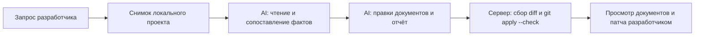

# День 35 — Смотритель: документация по актуальному коду

Локальный сервис сверяет README и документацию с исходниками проекта, исправляет подтверждённые расхождения и выдаёт документы, отчёт с доказательствами и unified diff.

## Реальная задача

После изменения кода описание API, настроек и архитектуры часто остаётся прежним. Разработчик тратит время на поиск расхождений и перенос фактов из кода в документацию. «Смотритель» берёт эту работу на себя: находит связанные файлы, сопоставляет утверждения с реализацией и сохраняет предлагаемые изменения для просмотра.

По умолчанию подключён существующий Spring Boot модуль [`../day32/sandbox`](../day32/sandbox), а не специально скопированный корпус. В нём реализован перенос бронирования через `PATCH`, которого нет в README. Можно подключить другой локальный проект через `PROJECT_DIR`.

## Запуск

Нужны JDK 21+, Git и ключ DeepSeek. Запускать анализируемое приложение, Ollama и индекс эмбеддингов не требуется.

```bash
cd day35
cp .env.example .env
# Указать DEEPSEEK_API_KEY и PROJECT_DIR в .env.
./run.sh
```

Интерфейс: http://localhost:8350. Файловый MCP: http://127.0.0.1:8351/mcp. Остановка — Ctrl+C в терминале запуска. Скрипт собирает и запускает оба сервиса, проверяет готовность и останавливает свои процессы при завершении. Журналы: `data/logs/`.

Путь `PROJECT_DIR` может быть абсолютным или относительным к папке `day35`. `WORKSPACES_DIR` должен находиться вне анализируемого проекта; для анализа корня этого репозитория задайте, например, отдельную папку в `/tmp`.

## Сценарий демонстрации

1. Открыть интерфейс и проверить подключённый проект в левой колонке.
2. Выбрать «Сверить документацию» и нажать «Выполнить задачу».
3. Справа наблюдать этапы, чтение исходников и запись файлов.
4. Во вкладке «Файлы» посмотреть обновлённые документы и `docs/sync-report.md`.
5. Во вкладке «Изменения» проверить diff и скачать `project.patch`.

Запрос для полного сценария:

> Сверь документацию проекта с актуальным кодом. Исправь подтверждённые расхождения в README и docs. Сохрани отчёт docs/sync-report.md с доказательствами и ограничениями.

Второй сценарий «Проверить API» сужает область до методов, путей, запросов, ответов и ошибок. Поле задачи позволяет дополнительно ограничить проверку конкретным модулем или разделом документации.

Исходный проект автоматически не изменяется. После просмотра скачанного патча его можно проверить и применить из корня того проекта, который указан в `PROJECT_DIR`:

```bash
git apply --check /полный/путь/project.patch
git apply /полный/путь/project.patch
```

Если источник изменился после создания снимка, интерфейс показывает предупреждение, а результат получает статус `incomplete`. В таком случае следует повторить сверку по актуальному коду.

## Пайплайн и роль AI



- **Снимок.** Сервер через MCP сохраняет исходный снимок и отдельную рабочую копию. Обе копии содержат одинаковые байты. Модель не выбирает исходную папку и идентификатор рабочей копии.
- **Сбор фактов.** До 5 ходов модели: обзор файлов, чтение документов, конфигурации и исходников, поиск. Модель сама выбирает файлы и сопоставляет реализацию с описанием.
- **Запись.** После перехода на этот этап поиск и обзор структуры убираются из доступных инструментов. Модель сохраняет исправления и обязательный `docs/sync-report.md`. Чтение остаётся доступным для получения актуального хеша перед записью документа. Общий лимит — 18 ходов, на последнем инструменты отключаются.
- **Проверка.** Сервер независимо собирает реальные изменения, проверяет наличие отчёта и чтения исходного кода, запускает `git apply --check` на исходном снимке и сравнивает его с текущим состоянием источника.

AI нужен для понимания кода, поиска смысловых расхождений и редактирования текста. Снимки, ограничения путей, проверка хешей, построение diff и его проверка выполняются обычным кодом.

Отчёт содержит область проверки, расхождения и исправления, доказательства вида `src/.../Controller.kt:42` и ограничения. Если расхождений не найдено, модель сохраняет отчёт о проверенных утверждениях; менять правильную документацию ради diff не требуется. Идентификатор снимка в отчёте связывает его с конкретным запуском.

Проверка сервера подтверждает наличие результатов и применимость патча к снимку. Она не доказывает содержательную точность документации: выводы и ссылки проверяет разработчик.

## Устройство

- `assistant` — Kotlin, Spring Boot, клиент DeepSeek с function calling, Vue 3, SSE для хода работы. Схемы инструментов берутся из MCP `tools/list`.
- `files-mcp` — Kotlin MCP SDK и streamable HTTP. Инструменты: `get_project`, `create_workspace`, `list_files`, `search_text`, `read_file`, `write_file`, `get_changes`. Первые два вызываются сервером, остальные доступны модели в соответствующем этапе.
- `data/workspaces/<uuid>/original` — исходный снимок; `project` рядом — предлагаемые изменения. `source-path.txt` хранит путь источника для проверки актуальности после перезапуска.
- `tools/smoke.py` — сквозная проверка реальной модели, MCP, отчёта, скачивания и точного применения патча.

Статусы: `completed` — структурные проверки пройдены; `incomplete` — отсутствует обязательный результат, достигнут лимит генерации или изменился источник; `failed` — ошибка сервиса. Частично сохранённые файлы доступны и при ошибке. История интерфейса живёт в текущей вкладке, рабочие копии остаются на диске. Список прочитанных файлов хранится в памяти MCP и сбрасывается при его перезапуске.

## Ограничения

- Это статическая проверка. Сервис не выполняет команды анализируемого проекта и не запускает его тесты. Формулировки «проверить запуск» означают сверку описания запуска с файлами проекта.
- Чтение поддерживает UTF-8 файлы с расширениями для Kotlin, Java, Python, JS/TS/Vue, Go, Rust, SQL, Markdown и ряда конфигурационных форматов. Пути внутри проекта должны состоять из ASCII-букв, цифр, `_`, `-` и точек. Имена с пробелами и кириллицей пропускаются. Абсолютный путь самой папки проекта может содержать такие символы.
- Скрытые файлы и каталоги, символические ссылки, `build`, `target`, `node_modules`, `dist`, `vendor`, `data`, `coverage`, `venv`, `__pycache__`, некоторые lock-файлы и имена с `secret`, `credential`, `token` исключены. Это фильтр файлов, а не поиск секретов внутри содержимого: подключайте проект, код и документацию которого допустимо отправлять провайдеру модели.
- Лимиты: 1500 файлов, 100 КБ на файл, 15 МБ на проект. Для большого репозитория подключайте конкретный модуль.
- Запись разрешена только в `README.md` и Markdown внутри `docs/` рабочей копии. Перед изменением существующего документа требуется чтение и актуальный SHA-256. Документы в других местах можно прочитать, но автоматически исправить нельзя.
- Файлы передаются модели как недоверенные данные. Защита от записи вне рабочей копии и изменения исходников обеспечивается файловым слоем.
- Ключ DeepSeek хранится на сервере в `.env` или переменных окружения. Оба сервиса слушают localhost; пользовательской аутентификации нет.

## Ошибки и метрики

Для обрыва, таймаута, 429 и 5xx DeepSeek предусмотрено до трёх попыток; неверный ключ не повторяется. Ошибки инструментов возвращаются модели для исправления аргументов. Наличие записи в отчёте не заменяет выполненное действие: интерфейс показывает фактически сохранённые файлы.

В интерфейсе доступны время, число прочитанных файлов, вызовов инструментов и оценка стоимости. Токены и ходы модели видны в трассировке. Цена задаётся через `LLM_INPUT_PRICE` и `LLM_OUTPUT_PRICE` в долларах за миллион токенов; это настраиваемая оценка, а не сверка счёта провайдера.

## Проверка

```bash
./gradlew :files-mcp:test :assistant:test :assistant:bootJar :files-mcp:installDist
# После запуска ./run.sh, с настроенным ключом:
python3 tools/smoke.py
# Повторно проверить сохранённый результат без нового запроса к AI:
python3 tools/smoke.py --check-saved
```

11 тестов проверяют изоляцию снимков, конфликт хеша, запрет записи кода и выхода за пределы рабочей копии, символические ссылки, исключение служебных файлов, лимит размера, изменение источника после снимка, точное применение diff и условия итогового статуса. Сквозная проверка дополнительно проверяет реальную ссылку на прочитанный исходник в отчёте, скачивание патча и неизменность подключённого проекта. Для стандартного `day32/sandbox` проверяются пропущенный `PATCH` и неверное описание контроллера как слоя без бизнес-проверок. Полные результаты — в игнорируемой папке `data/eval/`.

Сохранённый живой прогон на `deepseek-flash`: 11 прочитанных файлов, 9 ходов модели, 18 вызовов инструментов, 33,9 с, оценка стоимости $0.0356. Сохранены README, `docs/api.md` и отчёт; патч скачан и применён к чистому снимку с точным совпадением файлов. Эти значения относятся к одному прогону, а не к гарантированному времени или стоимости.

## Настройки

| Переменная | По умолчанию |
|---|---|
| `PROJECT_DIR` | `../day32/sandbox` |
| `WORKSPACES_DIR` | `data/workspaces` |
| `DEEPSEEK_API_KEY` | обязателен для запуска задачи |
| `DEEPSEEK_MODEL` | `deepseek-flash` |
| `PORT` | `8350` |
| `MCP_PORT` | `8351` |
| `FILES_MCP_URL` | `http://127.0.0.1:8351/mcp` |

Остальные параметры — в `assistant/src/main/resources/application.yml`.

## Что переиспользовано

Из дня 34 взяты файловый MCP, защита путей и хешей, клиент DeepSeek, цикл инструментов и интерфейс просмотра файлов и diff. Для дня 35 добавлены подключение настоящего локального проекта, фильтрация служебных файлов, ограничения объёма снимка, отдельный этап записи, отчёт о синхронизации, проверка применимости патча и обнаружение изменений источника.
